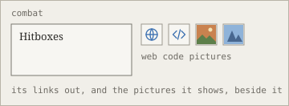

Each pane's header has a row of small icons. Each is a switch: it says what it is when you hover on it, and when on it takes its colour, with a bar under it. Each has a key.

**The note:**
- Provenance, whose words are whose (Alt+P).
- The timeline (Alt+T). Both are in [every change is kept](/notes/every-change-is-kept.md "uses").

**The Atlas:**
- Open questions (Alt+Q) and problems (Alt+B), on the map.
- Links to the web (Alt+W) and to code (Alt+K): see [links out of the base](/out-of-the-base/web-and-code-links.md "see also").
- Pictures (Alt+I): the pictures a note shows, small, beside it. One that's missing is marked.
- Iso's context (Alt+C): what Iso is sent, what it read and what it changed, marked on the map.

**Iso:**
- May it edit the notes (Alt+N). Off, Iso only reads and answers.
- With a terminal attached, may it edit the project's files (Alt+F) and run commands (Alt+R). See [isorite term](/terminal/isorite-term.md "see also").

At the right of each header, its settings: for the note, the layout of the panes and which are shown.

The switches show; they never change the notes. [The Atlas](/atlas/the-atlas.md "requires") is where most of them show.
