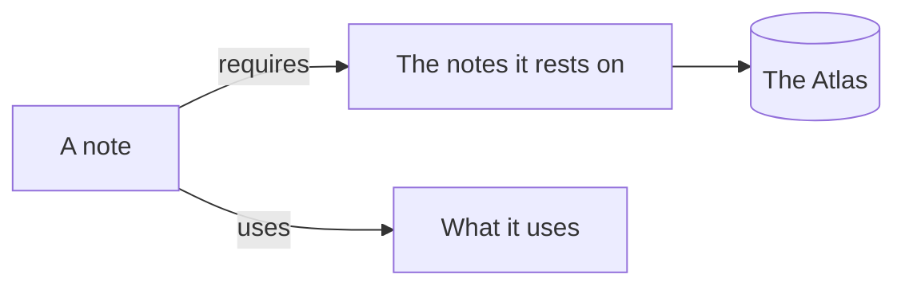
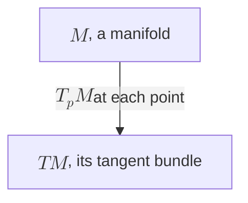

Name a fenced block's language after its opening fence, and its code is coloured by it:

```python
def leapfrog(x, v, a, dt):
    """One step: half a kick, a drift, half a kick."""
    v = v + 0.5 * dt * a(x)
    x = x + dt * v
    return x, v + 0.5 * dt * a(x)  # the second half kick
```

A block whose language is `mermaid` is drawn as a diagram, and stays Mermaid in the file:



Put the cursor in it to change it: its source shows, and the diagram is drawn again as you type. Maths in a label goes between double dollars:



Every kind of [Mermaid](https://mermaid.js.org/intro/ "see also") diagram is drawn, and [the agent](/agents/the-agent-pane.md "see also") draws one where it helps.

## Pictures

Paste a picture into a note, or drop one on it (png, jpeg, gif or webp, up to 5 MB). It is saved beside the note and linked where you pasted: ``. The words in the brackets are what the agent reads of it, since it reads the note and not the pixels: make them say what it shows. `"left"` after the path sets it at the left.

Dropped on a note on the Atlas, it is saved beside that note and linked at its end; on an island's bare ground, it is saved in that island. To show a picture already in the base, type `[[!` and choose it. One from your code's repository is shown with `code:`, as a [code link](/notes/web-and-code-links.md "see also") is.
