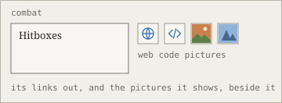

Each pane's header has a row of small icons. Each is a switch: hover for its name, and when on it takes its colour, with a bar under it. Their keys are in [shortcuts](/editing/shortcuts.md "see also").

- **The note**: provenance, whose words are whose, and the timeline. Both are in [every change is kept](/editing/every-change-is-kept.md "uses").
- **The Atlas**: open questions and problems; links to the web and to code ([links out](/notes/web-and-code-links.md "see also")); files beside the notes, such as pictures and [artifacts](/agents/artifacts.md "see also"); and the agent's context, what its session was given, read and changed.
- **Agent**: may agents edit the notes. It is kept with the base, so it holds for an agent in its own terminal too: its tools for writing are refused. With an agent attached, may it edit the project's files and run commands: see [your own agent](/agents/your-own-agent.md "see also").

The switches show; they never change the notes. At the right of each header are its settings.
