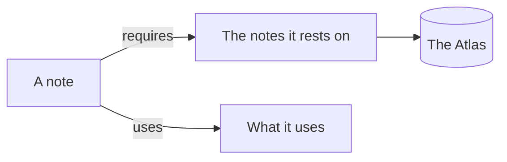
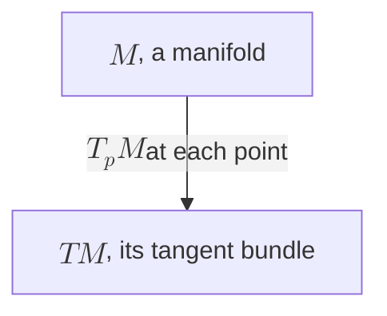

Name a fenced block's language after its opening fence, and its code is coloured by it:

```python
def leapfrog(x, v, a, dt):
    """One step: half a kick, a drift, half a kick."""
    v = v + 0.5 * dt * a(x)
    x = x + dt * v
    return x, v + 0.5 * dt * a(x)  # the second half kick
```

In the Note pane's settings, *the code* chooses colour, or ink as in print: keywords bold and comments faint.

A block whose language is `mermaid` is drawn as a diagram, and stays Mermaid in the file:



Put the cursor in it to change it: its source shows, and the diagram beneath it is drawn again as you type. A diagram that can't be drawn says why, in the line and column of its source. Maths in a label goes between double dollars, as Mermaid has it:



Every kind of diagram Mermaid draws is drawn: [flowcharts, sequences, states, classes, timelines and more](https://mermaid.js.org/intro/ "see also"). [Iso](/iso/iso.md "see also") draws one where a picture helps, or when you ask it for one.
